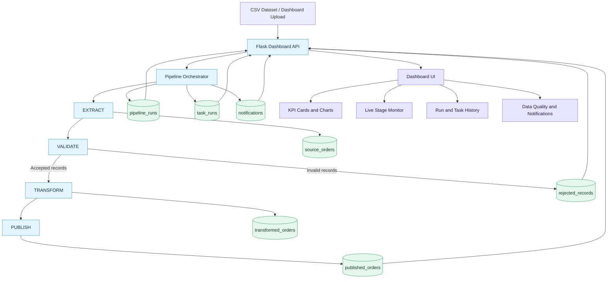

# FlowGuard Architecture Diagram

This diagram shows the main components and data flow in the current FlowGuard project.

## Component responsibilities

| Component | Responsibility |
|---|---|
| CSV dataset | Supplies order records for processing |
| Flask Dashboard API | Accepts uploads and serves dashboard data |
| Pipeline Orchestrator | Runs stages in order, manages retries, timeouts and task status |
| EXTRACT | Reads CSV input and stores source records |
| VALIDATE | Checks data quality and separates invalid records |
| TRANSFORM | Normalizes accepted records |
| PUBLISH | Reconciles and publishes transformed records |
| MySQL tables | Store source, transformed, rejected, published, run, task and notification data |
| Dashboard UI | Displays KPIs, charts, run history, task history and live progress |

## Important execution behaviour

- The normal execution order is EXTRACT → VALIDATE → TRANSFORM → PUBLISH.
- Invalid records are stored separately in `rejected_records`.
- A critical task failure prevents downstream stages from running.
- Task attempts and pipeline outcomes are recorded for audit and troubleshooting.
- The dashboard reads pipeline status and metrics through Flask API routes.

## Notes

This is a logical architecture diagram based on the current project structure and implemented features. It does not imply that FlowGuard currently uses a message broker, cloud orchestration service, distributed workers, or a separate frontend server.
